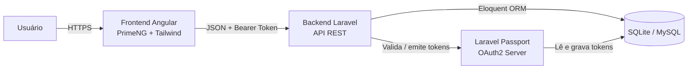
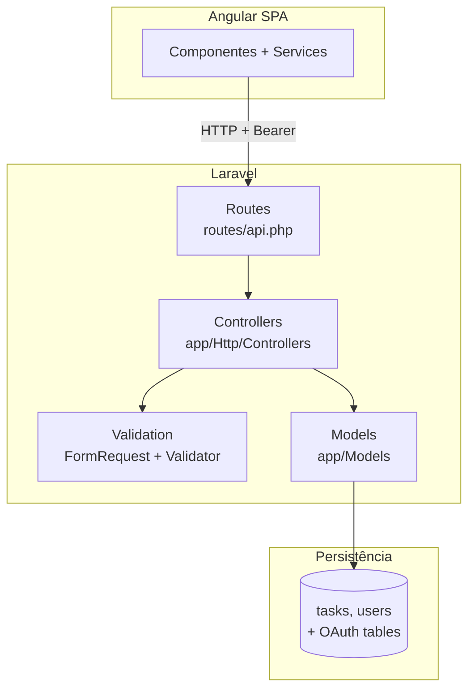

# Task Management CRUD API

**Front-end**


**Back-end**


**Banco de dados**


**Testes e infraestrutura**


Aplicação de gerenciamento de tarefas em monorepo: **backend** (API RESTful em Laravel, com autenticação OAuth2 via Laravel Passport) em `/backend` e **frontend** (Angular + PrimeNG) em `/frontend`. Toda a comunicação entre as duas pontas passa por JSON + `Authorization: Bearer {token}`. Os endpoints e os pacotes do backend são detalhados abaixo.

---

## 📋 Sobre o projeto

A API expõe um CRUD de tarefas vinculadas ao usuário autenticado. Cada usuário enxerga apenas as próprias tarefas (escopo aplicado no controller a partir de `auth('api')->id()`) e as rotas de tarefas exigem um token OAuth2 válido emitido por `POST /api/login`.

Funcionalidades cobertas:

- Autenticação por **Password Grant** (Passport) e proteção das rotas sensíveis com o middleware `auth:api`.
- CRUD completo de tarefas (criar, listar com paginação, mostrar, atualizar, excluir) com eager loading do relacionamento `user` e validação em `StoreTaskRequest` / `UpdateTaskRequest`.
- Filtros e ordenação em `GET /api/tasks` por `id`, `tarefa`, `status`, `prioridade`, `criado_em`, `atualizado_em` e `user.name`.
- **Gestão da conta logada:** cadastro (`POST /api/users`), troca de nome com confirmação de senha (`PUT /api/users`) e exclusão da conta junto com as tarefas (`DELETE /api/users`).
- **Estatísticas** do usuário logado por status (`GET /api/stats`), exibidas em um gráfico no frontend.
- Frontend com telas de login, cadastro e home (tabela de tarefas, filtros, modais de criação, edição e confirmação).
- Execução em containers com Docker Compose.

## 🛠️ Tecnologias

**Backend** (`backend/`)

| Camada | Tecnologia | Versão |
| --- | --- | --- |
| Linguagem | PHP | `^8.3` |
| Framework | Laravel | `^13.17` |
| Auth OAuth2 | Laravel Passport | `^13.0` |
| ORM | Eloquent (SQLite default, MySQL opcional) | — |
| Testes | Pest + Pest Laravel Plugin | `^5.2` |
| Lint/Formatação | Laravel Pint | `^1.27` |
| Localização | lucascudo/laravel-pt-br-localization | `^3.0` |

**Frontend** (`frontend/`) — documentado em `/frontend/README.md`

| Camada | Tecnologia | Versão |
| --- | --- | --- |
| Framework | Angular (standalone) | `^21.2` |
| UI Kit | PrimeNG + PrimeUIX themes + PrimeIcons | `^21.1` |
| Ícones | FontAwesome (free solid) | `^7.1` |
| Gráficos | Chart.js | `^4.5` |
| Estilo utilitário | Tailwind CSS v4 | `^4.1` |
| Testes | Vitest + jsdom | `^4.0` |

## 🏛️ Arquitetura

Monorepo com dois pacotes isolados: `backend/` (Laravel) e `frontend/` (Angular). O frontend consome a API via HTTP; o backend é stateless e delega sessão/estado ao Passport (tokens persistidos no banco).



Camadas do backend:



Estrutura do frontend (`frontend/src/app`):

| Pasta / arquivo | Responsabilidade |
| --- | --- |
| `pages/login`, `pages/sign-up`, `pages/home` | Telas da aplicação. Rotas: `/` (login), `/signup` e `/home`. |
| `guards/auth-guard.ts` | `authGuard`: protege a rota `/home`. |
| `services/api-service.ts` | Todas as chamadas HTTP à API, com o token enviado no header `Authorization`. |
| `services/notification-service.ts` | Notificações de sucesso e erro. |
| `ui/` | Componentes reutilizáveis: tabela (`table-prime`), modais (`modal`, `confirm-modal`, `password-modal`), `notification`, `loading` e `button`. |

O `ApiService` guarda as respostas de `GET /api/tasks` e `GET /api/stats` em memória (`shareReplay`) e limpa esse cache a cada operação que altera dados (login, cadastro, criar, editar e excluir tarefa, trocar nome). O token fica no `localStorage`.

Repositório: <https://github.com/Guilh3rme-August0-bs/laravel-task-management-api>

## ✅ Pré-requisitos

- **PHP 8.3+** com extensões `pdo_sqlite` (default) ou `pdo_mysql` (caso troque o driver).
- **Composer 2.x**.
- **Node.js 20+** e **npm 10+** apenas se você for rodar o frontend em `../frontend`.
- Opcional: **Docker** + **Docker Compose** para rodar backend e frontend em containers (ver [Executando com Docker](#-executando-com-docker)).

> Em Linux, o jeito mais rápido de obter PHP + Composer é o [`php.new`](https://php.new): `curl -fsSL https://php.new/install/linux/8.3 | bash`.

## 🚀 Instalação

```bash
# 1. Entrar no pacote de backend
cd backend

# 2. Instalar dependências PHP
composer install

# 3. Copiar e ajustar variáveis de ambiente
cp .env.example .env
php artisan key:generate

# 4. Criar o banco e instalar o Passport
php artisan migrate
php artisan passport:install     # cria clientes OAuth2 e chaves de assinatura

# 5. Subir o servidor de desenvolvimento
php artisan serve --port=8000
```

A API passa a responder em `http://localhost:8000`. O frontend (em outro terminal) sobe com `npm start` dentro de `frontend/` e consome `http://localhost:8000/api`.

## 🐳 Executando com Docker

Backend e frontend têm um `Dockerfile` cada e o `docker-compose.yml` na raiz do repositório sobe os dois serviços juntos.

| Serviço | Base | Porta | Comando de execução |
| --- | --- | --- | --- |
| `backend` | `php:8.4-cli` + Composer | `8000` | `php artisan serve --host=0.0.0.0 --port=8000` |
| `frontend` | `node:22-alpine` | `4200` | `npm start -- --host 0.0.0.0` |

### Preparação (uma única vez)

O `.env`, o banco SQLite e as chaves do Passport **não ficam na imagem**: o `docker-compose.yml` os injeta na hora de subir, a partir de `backend/` na sua máquina. Por isso eles precisam existir antes do primeiro `docker compose up`. Se algum não existir, o Docker cria uma **pasta** com esse nome e o Laravel falha.

Execute os passos 2 a 4 da seção [Instalação](#-instalação) para gerar:

- `backend/.env` com `APP_KEY` preenchida (`cp .env.example .env` e `php artisan key:generate`).
- `backend/database/database.sqlite`, já migrado (`php artisan migrate`).
- `backend/storage/oauth-private.key` e `backend/storage/oauth-public.key` (`php artisan passport:install`).

Esses arquivos estão no `.gitignore` e não são versionados, então cada pessoa que clonar o projeto precisa gerá-los.

### Subir e parar

```bash
# Na raiz do repositório
docker compose up --build        # constrói as imagens e sobe os dois serviços
docker compose up -d             # mesmo comando, em segundo plano
docker compose logs -f backend   # acompanha o log do backend
docker compose down              # para e remove os containers
```

Com os serviços no ar:

- Frontend: <http://localhost:4200>
- API: <http://localhost:8000/api>

### Como funciona

| Item do `docker-compose.yml` | Função |
| --- | --- |
| `env_file: ./backend/.env` | Entrega as variáveis (incluindo `APP_KEY`) ao container. |
| volume `database.sqlite` | Mantém o banco na sua máquina. Usuários e tarefas continuam existindo depois de `docker compose down`. |
| volumes `oauth-*.key` (somente leitura) | Fornecem as chaves usadas pelo Passport para assinar os tokens. |
| `depends_on: backend` | O frontend inicia depois do backend. |

### Problemas comuns

- **`port is already allocated`** — outro container ou processo usa a porta. Veja com `docker ps` ou `ss -ltnp | grep 8000` e pare o processo, ou troque o lado esquerdo do mapeamento (ex.: `"8001:8000"`).
- **Cadastro funciona, mas o login falha** — confira se `backend/.env` existe e tem `APP_KEY`, se as duas chaves `oauth-*.key` estão em `backend/storage/` e veja o erro com `docker compose logs backend`.
- **Mudei o código e nada mudou** — o código é copiado para a imagem no build. Rode `docker compose up --build` para reconstruir.

## 💾 Banco de dados e seed

O projeto usa **SQLite** por padrão (`DB_CONNECTION=sqlite` em `.env.example`) — não é necessário subir um SGBD externo para o ambiente local. Se preferir MySQL, descomente e preencha o bloco `DB_*` no `.env` antes de rodar as migrations.

```bash
# Criar o arquivo do SQLite (somente na primeira vez, em SQLite)
touch database/database.sqlite

# Rodar todas as migrations (cria users, tasks, OAuth2 tables, etc.)
php artisan migrate

# (Opcional) Popular o banco com dados de exemplo
php artisan db:seed
```

O `DatabaseSeeder` cria um único usuário de teste:

| Campo | Valor |
| --- | --- |
| `name` | `Test User` |
| `email` | `test@example.com` |
| `password` | `password` |

> Não existe factory/seed de tarefas. Para popular manualmente, use `POST /api/tasks` autenticado, a tela de criação do frontend ou `php artisan tinker`.

> **Chave primária de `users`:** a coluna se chama `user_id` (não `id`). O model `User` define `$primaryKey = 'user_id'` e `tasks.user_id` referencia essa coluna. Por isso as respostas da API trazem `user_id` nos objetos de usuário.

## 🔐 Variáveis de ambiente

Copie `.env.example` para `.env` e ajuste conforme necessário. Principais chaves:

| Variável | Obrigatório | Descrição |
| --- | --- | --- |
| `APP_NAME` | sim | Nome exibido em logs e-mails. |
| `APP_ENV` | sim | `local`, `production`, etc. |
| `APP_KEY` | sim | Gerado por `php artisan key:generate`. |
| `APP_DEBUG` | sim | `true` em dev, `false` em produção. |
| `APP_URL` | sim | URL base do backend (ex.: `http://localhost:8000`). |
| `APP_LOCALE` | recomendado | O `.env.example` vem com `en`. Use `pt_BR` para mensagens de validação em português (as traduções estão em `lang/pt_BR`). |
| `DB_CONNECTION` | sim | `sqlite` (default) ou `mysql`. |
| `DB_HOST` / `DB_PORT` / `DB_DATABASE` / `DB_USERNAME` / `DB_PASSWORD` | se MySQL | Credenciais do SGBD. |
| `SESSION_DRIVER` | sim | Default do `.env.example`: `database`. |
| `CACHE_STORE` | sim | Default: `database`. |
| `QUEUE_CONNECTION` | sim | Default: `database` (pode ir para `sync` em dev). |
| `LOG_CHANNEL` / `LOG_LEVEL` | sim | Stack de logs; default `stack` / `debug`. |
| `MAIL_MAILER` | sim | `log` em dev — e-mails vão para `storage/logs`. |
| `PASSPORT_PRIVATE_KEY` / `PASSPORT_PUBLIC_KEY` | produção | Conteúdo das chaves, usado no lugar dos arquivos `storage/oauth-*.key` (lidos em `config/passport.php`). |

> O `php artisan passport:install` gera as chaves em `storage/oauth-private.key` e `storage/oauth-public.key` e cria os clients OAuth2. Reexecute o comando apenas se quiser rotacionar credenciais.

## 📡 Endpoints da API

Base URL local: `http://localhost:8000/api`.

| Exigem `Authorization: Bearer {token}` (`auth:api`) | Sem middleware de autenticação |
| --- | --- |
| `GET /`, `/tasks` (CRUD completo), `PUT /users`, `DELETE /users` | `POST /login`, `GET /users`, `POST /users`, `GET /stats`\*, `GET /service`, `POST /request` |

\* `GET /stats` não tem o middleware, mas o controller lê o usuário pelo token (`auth('api')->id()`). Sem token válido a resposta é uma lista vazia.

### Autenticação

#### `POST /login`

Autentica o usuário via Password Grant e devolve o access token.

```bash
curl --location --request POST 'http://localhost:8000/api/login' \
  --header 'Content-Type: application/json' \
  --header 'Accept: application/json' \
  --data-raw '{
      "email": "test@example.com",
      "password": "password"
  }'
```

**200**
```json
{
  "user": { "user_id": 1, "name": "Test User", "email": "test@example.com" },
  "token": "eyJ0eXAiOiJKV1QiLCJhbGc..."
}
```

**401**
```json
{ "message": "Credenciais inválidas" }
```

#### `GET /` (rota interna, `auth:api`)

Retorna o usuário dono do token atual.

### Tarefas (`/tasks`)

Todas as rotas deste bloco estão sob `auth:api` e operam **apenas sobre as tarefas do usuário autenticado** (`where user_id = auth('api')->id()`). O relacionamento `user` é carregado via eager loading com `select('user_id','name')`.

#### `POST /tasks`

Cria uma tarefa e a vincula automaticamente ao usuário do token.

```bash
curl --location --request POST 'http://localhost:8000/api/tasks' \
  --header 'Content-Type: application/json' \
  --header 'Accept: application/json' \
  --header 'Authorization: Bearer {seu-token}' \
  --data-raw '{
      "tarefa": "Implementar autenticação",
      "descricao": "Adicionar OAuth2 com Laravel Passport",
      "status": "PENDENTE",
      "prioridade": "ALTA"
  }'
```

**Regras de validação (`StoreTaskRequest`)**

- `tarefa`: obrigatório, string, máx. 50 caracteres, **único** na tabela.
- `descricao`: opcional, string, máx. 255 caracteres.
- `status`: obrigatório, `PENDENTE | EM_ANDAMENTO | CONCLUIDA`.
- `prioridade`: obrigatório, `BAIXA | MEDIA | ALTA`.

Em caso de falha, a API responde `422` no formato padrão do Laravel (`message` + `errors`), com as mensagens em português definidas no `FormRequest`.

**200**
```json
{
  "nova_tarefa": {
    "id": 1,
    "tarefa": "Implementar autenticação",
    "descricao": "Adicionar OAuth2 com Laravel Passport",
    "status": "PENDENTE",
    "prioridade": "ALTA",
    "user_id": 1,
    "created_at": "2026-10-02T10:52:00.000000Z",
    "updated_at": "2026-10-02T10:52:00.000000Z"
  }
}
```

#### `GET /tasks`

Lista paginada das tarefas do usuário, com filtros e ordenação.

**Parâmetros de query**

| Param | Tipo | Valores aceitos | Default |
| --- | --- | --- | --- |
| `per_page` | int | `10`, `20`, `25`, `50`, `100` | `10` |
| `sort_by` | string | `id`, `tarefa`, `descricao`, `status`, `prioridade`, `created_at`, `updated_at`, `user.name` | — |
| `sort_order` | string | `asc`, `desc` | — |
| `filter_id` | int | — | — |
| `filter_tarefa` | string | contém (LIKE) | — |
| `filter_status` | string | `PENDENTE | EM_ANDAMENTO | CONCLUIDA` | — |
| `filter_prioridade` | string | `BAIXA | MEDIA | ALTA` | — |
| `filter_usuario` | string | validado, mas **ainda não aplicado** à consulta | — |
| `filter_criado_em` | date | `YYYY-MM-DD` | — |
| `filter_atualizado_em` | date | `YYYY-MM-DD` | — |

```bash
curl --location --request GET 'http://localhost:8000/api/tasks?per_page=20&filter_status=PENDENTE&sort_by=user.name&sort_order=asc' \
  --header 'Accept: application/json' \
  --header 'Authorization: Bearer {seu-token}'
```

**200**
```json
{
  "tarefas:": {
    "current_page": 1,
    "data": [
      {
        "id": 1,
        "tarefa": "Implementar autenticação",
        "descricao": "Adicionar OAuth2 com Laravel Passport",
        "status": "PENDENTE",
        "prioridade": "ALTA",
        "user_id": 1,
        "created_at": "2026-10-02T10:52:00.000000Z",
        "updated_at": "2026-10-02T10:52:00.000000Z",
        "user": { "user_id": 1, "name": "Test User" }
      }
    ],
    "first_page_url": "http://localhost:8000/api/tasks?page=1",
    "from": 1,
    "last_page": 1,
    "last_page_url": "http://localhost:8000/api/tasks?page=1",
    "links": [],
    "next_page_url": null,
    "path": "http://localhost:8000/api/tasks",
    "per_page": 10,
    "prev_page_url": null,
    "to": 1,
    "total": 1
  }
}
```

#### `GET /tasks/{id}`

Detalhe de uma tarefa do usuário autenticado. `404` quando não encontrada.

```bash
curl --location --request GET 'http://localhost:8000/api/tasks/1' \
  --header 'Accept: application/json' \
  --header 'Authorization: Bearer {seu-token}'
```

**200**
```json
{
  "tarefa selecionada:": {
    "id": 1,
    "tarefa": "Implementar autenticação",
    "descricao": "Adicionar OAuth2 com Laravel Passport",
    "status": "PENDENTE",
    "prioridade": "ALTA",
    "user_id": 1,
    "created_at": "2026-10-02T10:52:00.000000Z",
    "updated_at": "2026-10-02T10:52:00.000000Z",
    "user": { "user_id": 1, "name": "Test User" }
  }
}
```

**404**
```json
{ "message": "No query results for model [App\\Models\\Task] {id}" }
```

#### `PUT /tasks/{id}`

Atualiza uma tarefa do usuário. Usa `App\Http\Requests\UpdateTaskRequest` (valida `tarefa` como única exceto a própria tarefa).

```bash
curl --location --request PUT 'http://localhost:8000/api/tasks/1' \
  --header 'Content-Type: application/json' \
  --header 'Accept: application/json' \
  --header 'Authorization: Bearer {seu-token}' \
  --data-raw '{
      "tarefa": "Implementar autenticação",
      "descricao": "OAuth2 implementado com sucesso",
      "status": "CONCLUIDA",
      "prioridade": "ALTA"
  }'
```

**200**
```json
{
  "tarefa atualizada": {
    "id": 1,
    "tarefa": "Implementar autenticação",
    "descricao": "OAuth2 implementado com sucesso",
    "status": "CONCLUIDA",
    "prioridade": "ALTA",
    "user_id": 1,
    "created_at": "2026-10-02T10:52:00.000000Z",
    "updated_at": "2026-10-02T11:00:00.000000Z",
    "user": { "user_id": 1, "name": "Test User" }
  }
}
```

#### `DELETE /tasks/{id}`

Hard delete. Retorna a tarefa removida. `404` quando não encontrada.

```bash
curl --location --request DELETE 'http://localhost:8000/api/tasks/1' \
  --header 'Accept: application/json' \
  --header 'Authorization: Bearer {seu-token}'
```

**200**
```json
{
  "tarefa excluída": {
    "id": 1,
    "tarefa": "Implementar autenticação",
    "descricao": "OAuth2 implementado com sucesso",
    "status": "CONCLUIDA",
    "prioridade": "ALTA",
    "user_id": 1,
    "created_at": "2026-10-02T10:52:00.000000Z",
    "updated_at": "2026-10-02T11:00:00.000000Z",
    "user": { "user_id": 1, "name": "Test User" }
  }
}
```

### Usuários (`/users`)

`GET` e `POST` são abertos (o `POST` é usado pela tela de cadastro). `PUT` e `DELETE` estão sob `auth:api` e atuam sempre sobre o **usuário dono do token**, sem receber id na URL. **O `GET /users` expõe todos os usuários e deve ser protegido ou removido antes de ir para produção.**

#### `GET /users`

Lista todos os usuários (rota aberta).

```bash
curl --location --request GET 'http://localhost:8000/api/users' \
  --header 'Accept: application/json'
```

**200**
```json
{ "usuários": [ { "user_id": 1, "name": "Test User", "email": "test@example.com" } ] }
```

#### `POST /users`

Cria um usuário. Validação: `name` (obrigatório, máx. 255), `email` (obrigatório, único), `password` (obrigatório, mín. 8).

```bash
curl --location --request POST 'http://localhost:8000/api/users' \
  --header 'Content-Type: application/json' \
  --header 'Accept: application/json' \
  --data-raw '{
      "name": "Fulano",
      "email": "fulano@example.com",
      "password": "segredo123"
  }'
```

**200**
```json
{ "usuário criado": { "name": "Fulano", "email": "fulano@example.com", "user_id": 2 } }
```

Dados inválidos (e-mail repetido, senha curta) retornam `422`.

#### `PUT /users` (`auth:api`)

Troca o nome do usuário logado. Exige a senha atual como confirmação. Validação: `newUsername` (obrigatório, máx. 255) e `password` (obrigatório).

```bash
curl --location --request PUT 'http://localhost:8000/api/users' \
  --header 'Content-Type: application/json' \
  --header 'Accept: application/json' \
  --header 'Authorization: Bearer {seu-token}' \
  --data-raw '{
      "newUsername": "Novo Nome",
      "password": "segredo123"
  }'
```

**200**
```json
{ "usuário atualizado": { "user_id": 2, "name": "Novo Nome", "email": "fulano@example.com" } }
```

**401**
```json
{ "message": "Senha incorreta." }
```

#### `DELETE /users` (`auth:api`)

Exclui o usuário logado **e todas as tarefas dele**. Não recebe parâmetros.

```bash
curl --location --request DELETE 'http://localhost:8000/api/users' \
  --header 'Accept: application/json' \
  --header 'Authorization: Bearer {seu-token}'
```

**200**
```json
{ "usuário deletado": "Fulano" }
```

### Estatísticas (`/stats`)

Devolve a contagem de tarefas por status do usuário identificado pelo token (`StatsController@getStatsByUser`). A rota não tem o middleware `auth:api`, mas o filtro usa `auth('api')->id()`: sem token válido o resultado é uma lista vazia. O frontend usa esta resposta para montar o gráfico da barra lateral.

```bash
curl --location --request GET 'http://localhost:8000/api/stats' \
  --header 'Accept: application/json' \
  --header 'Authorization: Bearer {seu-token}'
```

**200**
```json
[
  {
    "usuario_id": 1,
    "usuario_nome": "Test User",
    "total_tarefas": 12,
    "tarefas_pendentes": 5,
    "tarefas_em_andamento": 4,
    "tarefas_concluidas": 3
  }
]
```

> O `StatsController` também tem o método `getStats` (totais gerais de todas as tarefas), mas ele não está ligado a nenhuma rota.

### Rotas auxiliares (estudo / playground)

- `GET /service` — endpoint do `DIController` que exercita **injeção de dependência** com `App\services\TaskService`. Útil para validar o container.
- `POST /request` — endpoint do `RequestController` que devolve metadados do request (`path`, `url`, `host`, `schemeAndHttpHost`, etc.) e valida um payload mínimo. Útil para debugging.

> Documentação OpenAPI/Swagger ainda não está publicada — ver [melhorias futuras](#melhorias-futuras).

## 🌿 Fluxo Git

O repositório adota **Conventional Commits** para mensagens e **feature branches** para integrar o trabalho.

| Branch | Papel |
| --- | --- |
| `main` | Branch estável, destino dos Pull Requests. |
| `develop` | Branch de integração do desenvolvimento diário. |
| `feat/*` | Branches de funcionalidades (ex.: `feat/redis-cache`). |

| Tipo de commit | Quando usar |
| --- | --- |
| `feat` | Nova funcionalidade (ex.: `feat: botão de logout`). |
| `fix` | Correção de bug (ex.: `fix: correção do bug onde os filtros eram ativados pelos controles de paginação`). |
| `style` | Mudança visual que não altera comportamento (ex.: `style: tabela centralizada`). |
| `refactor` | Reorganização interna sem mudar contrato. |
| `docs` | Mudanças apenas na documentação. |
| `chore` | Tarefas de manutenção (deps, configs, CI). |

**Fluxo padrão:**

1. Crie uma branch a partir de `develop` (ou `main`): `git checkout -b feat/minha-feature`.
2. Faça commits pequenos e descritivos seguindo o padrão acima.
3. Abra um Pull Request descrevendo o que mudou e como testar.
4. Após a revisão, faça o merge (squash ou merge commit, a critério do reviewer).

**Referência:** o PR **#1** (`feat: migração de UI para PrimeNG`) foi merged em `main` a partir da branch `primeng` — é o exemplo canônico do fluxo adotado.

```text
0bc8a3f Merge pull request #1 from Guilh3rme-August0-bs/primeng
```

## 💡 Decisões técnicas, limitações e melhorias

### Decisões técnicas

- **OAuth2 Password Grant via Passport** — apropriado para um cliente SPA próprio. Para integrações com terceiros, expanda para *Authorization Code* + PKCE.
- **SQLite como default de desenvolvimento** — zero infra para rodar localmente; MySQL continua disponível descomentando o bloco `DB_*` no `.env`.
- **Hard delete em tarefas** — simples e suficiente para o escopo atual; troca para soft delete é uma migration simples.
- **Eager loading com `select('user_id','name')`** no relacionamento `user` — evita N+1 e reduz o payload.
- **Chave primária `user_id` em `users`** — o model `User` define `$primaryKey = 'user_id'` e a relação com `tasks` usa essa coluna nos dois lados.
- **Escopo por usuário no controller** — `Task::where('user_id', auth('api')->id())` em todas as operações sensíveis.
- **Validação com `FormRequest`** — `StoreTaskRequest` e `UpdateTaskRequest` concentram regras e mensagens em português. `index`, `UserController` e `RequestController` ainda usam `Validator::make` inline.
- **Estatísticas por SQL agregado** — `StatsController` usa `COUNT(CASE WHEN ...)` em uma única consulta, em vez de carregar as tarefas em memória.
- **Cache de leituras no frontend** — `ApiService` guarda `GET /tasks` e `GET /stats` com `shareReplay` e invalida o cache a cada operação que altera dados.
- **Locale** — as traduções `pt_BR` estão em `lang/`, mas o `.env.example` define `APP_LOCALE=en`. Ajuste o `.env` para usá-las.
- **Frontend standalone (Angular 21) + PrimeNG + Tailwind v4** — componentes prontos (table, paginator, modal, toast) aceleram a entrega sem abrir mão de customização visual. Chart.js exibe as estatísticas.
- **Docker Compose para desenvolvimento** — um comando sobe backend e frontend (ver [Executando com Docker](#-executando-com-docker)).

### Limitações conhecidas

- **Sem OpenAPI/Swagger** — a documentação de endpoints é manual e vive apenas neste README.
- **Docker voltado a desenvolvimento** — o `docker-compose.yml` sobe `php artisan serve` e `ng serve`, sem hot reload (o código é copiado no build) e sem serviço de banco separado (SQLite via volume). Não é uma configuração de produção.
- **Imagem do backend leva arquivos locais** — o `backend/.dockerignore` não exclui `database/*.sqlite` nem `storage/*.key`, então o `COPY . .` os copia para a imagem (os volumes os sobrepõem em tempo de execução). Adicione esses padrões ao `.dockerignore` antes de publicar a imagem.
- **Endpoints sem `auth:api`** — `GET /users` lista todos os usuários, `POST /users` é aberto (necessário para o cadastro), e `/stats`, `/service` e `/request` não têm middleware. Proteja ou remova os que não forem necessários antes de expor a API.
- **URL da API fixa no frontend** — `api-service.ts` usa `http://localhost:8000/api` em todas as chamadas, sem arquivo de ambiente. Para outro host é preciso editar o código.
- **`filter_usuario` sem efeito** — o parâmetro é validado em `GET /tasks`, mas não filtra a consulta.
- **`StatsController@getStats` sem rota** — o método de totais gerais existe, mas só `getStatsByUser` está ligado em `/stats`.
- **Cache do frontend em memória** — é perdido ao recarregar a página.
- **Sanctum instalado, mas sem uso** — `laravel/sanctum` está no `composer.json`; a autenticação das rotas usa apenas Passport (`auth:api`).
- **Sem refresh token rotation** configurado — apenas access tokens Password Grant.
- **Sem soft delete** — `DELETE /tasks/{id}` é hard delete.
- **`tarefa` é globalmente única** (não escopada por usuário) — pode gerar conflito de nomes entre contas distintas.
- **Sem factory/seed de tarefas** — apenas o `UserFactory` é populado pelo `DatabaseSeeder`.
- **Cobertura de testes** — a suíte do backend tem apenas os testes de exemplo (`ExampleTest`, `CacheSystemTest`). Não há testes para os endpoints de tasks/users/stats.
- **Validação inline remanescente** — `index`, `UserController` e `RequestController` ainda não usam `FormRequest`.
- **Sem API Resources** — as respostas devolvem o model cru dentro de chaves descritivas (`nova_tarefa`, `tarefas:`, etc.).

### Melhorias futuras

1. **OpenAPI/Swagger** — publicar a especificação (ex.: `darkaonline/l5-swagger`) e servir `GET /api/documentation`.
2. **Evoluir o Docker Compose** — montar o código como volume para ter hot reload, adicionar um serviço `db` (MySQL) e criar um build multi-stage de produção com PHP-FPM + nginx.
3. **Refresh tokens + revogação** — habilitar `passport:client --personal` com lifetimes explícitos e rotação.
4. **Autorização por Policy** — `TaskPolicy@view/update/delete` amarrada ao `user_id`.
5. **Soft delete + audit log** — `SoftDeletes` em `Task` + tabela `task_audits`.
6. **Factory e seed de tarefas** — popular dados de exemplo por usuário.
7. **Cobertura Pest** — testes de feature para `auth`, `tasks` (incluindo ownership), `users` e `stats`.
8. **URL da API por ambiente** — mover `http://localhost:8000/api` para os arquivos de environment do Angular.
9. **Corrigir `filter_usuario`** e proteger `GET /users` e `/stats` com `auth:api`.
10. **Rate limiting** — `throttle:api` + `throttle:login` para mitigar brute force.
11. **API Resources** — padronizar envelopes de resposta (`data`, `meta`, `errors`).
12. **CI no GitHub Actions** — pipeline com `composer install`, `pint --test`, `php artisan test`.

## 🔗 Links úteis

- **Repositório:** <https://github.com/Guilh3rme-August0-bs/laravel-task-management-api>
- **PR #1 (referência de fluxo):** [Merge pull request #1 from Guilh3rme-August0-bs/primeng](https://github.com/Guilh3rme-August0-bs/laravel-task-management-api/pull/1)
- **Laravel:** <https://laravel.com/docs>
- **Laravel Passport:** <https://laravel.com/docs/passport>
- **Pest:** <https://pestphp.com>
- **Documentação OpenAPI (referência para evolução):** <https://swagger.io/specification/>

> **Status de deploy:** esta API ainda não está publicada em ambiente público. Os links acima apontam para o repositório e o PR de referência; URLs de staging/produção serão adicionadas aqui assim que o deploy for provisionado.
